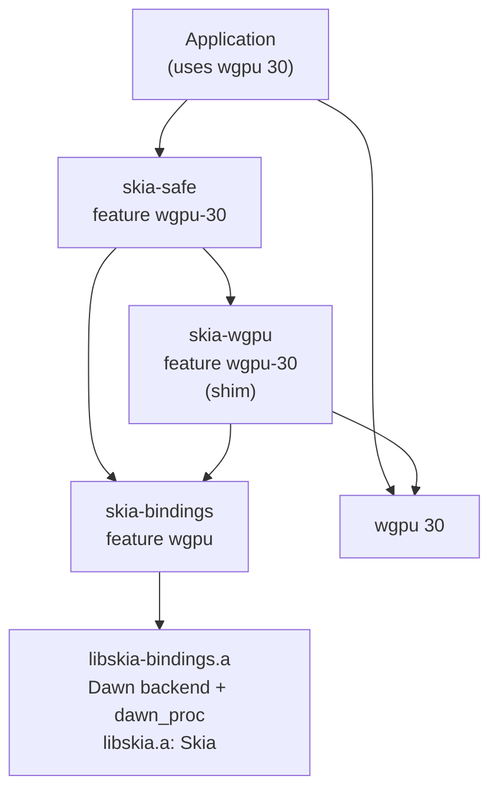
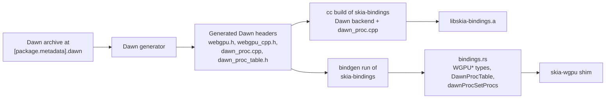
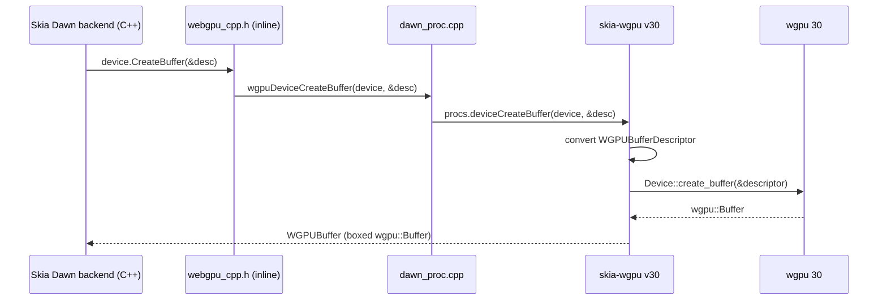
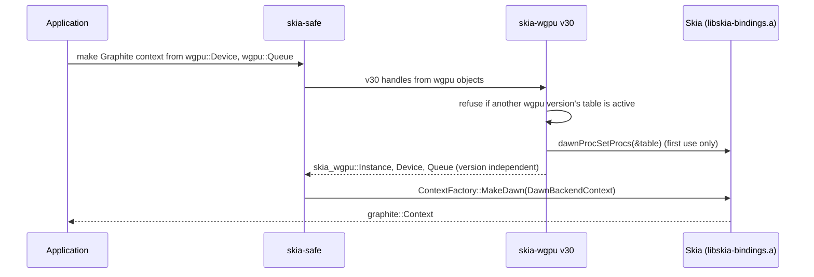
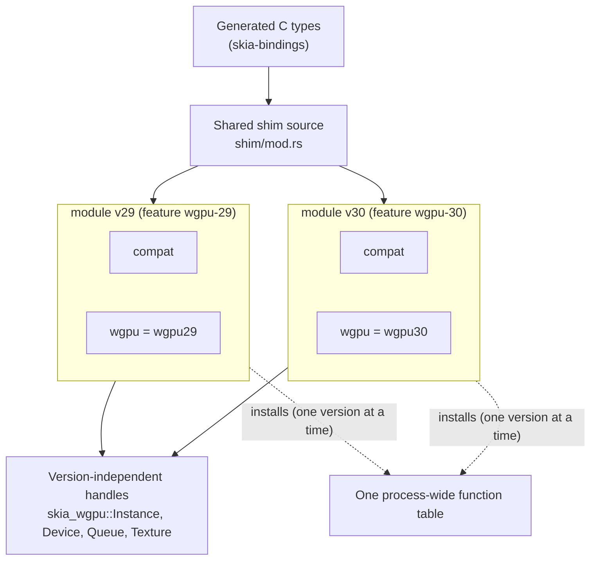

# Skia on `wgpu`: architecture

This document shows how Skia runs inside a `wgpu` application. The decisions behind it are recorded
in ADR 0003 (Skia runs on the `wgpu` crate through a shim behind Dawn's function table).

Terms used below:

- **Dawn backend**: Skia's Graphite backend for WebGPU. Skia names it after Dawn, Google's C++
  WebGPU implementation, but rust-skia links none of Dawn's implementation.
- **Dawn headers**: the C header `webgpu.h`, the C++ wrapper `webgpu_cpp.h`, and the `dawn_proc`
  files. Dawn's generator produces them during source builds with the `wgpu` feature, from the
  Dawn revision in `[package.metadata].dawn` of `skia-bindings`.
- **Function table**: Dawn's `DawnProcTable`, a C struct with one function pointer per WebGPU
  function. `dawnProcSetProcs` installs it for the whole process.
- **Shim**: the Rust code in `skia-wgpu` that fills the function table with functions that call
  `wgpu`.

## Crate dependencies

An arrow points from a crate to a crate it depends on. `skia-safe` depends on `skia-wgpu`, which
depends on `skia-bindings`.

The application and `skia-wgpu` must resolve to the same `wgpu` major version, so that a
`wgpu::Device` of the application is the type the shim accepts.

## Build inputs

The generated Dawn headers feed both the compilation of Skia's Dawn backend and bindgen. Struct layouts, enum values,
and function signatures therefore come from one source on both sides of the function table.

## Path of one WebGPU call

When Skia creates a buffer, the call leaves Skia's C++ code through Dawn's C++ wrapper, passes the
function table inside `libskia-bindings.a`, and arrives in the shim, which calls `wgpu`.

`wgpu` then runs the work on whichever native API it uses: Metal, Vulkan, Direct3D 12, or
OpenGL ES.

## Creating a Graphite context

The application passes its own `wgpu` objects to `skia-safe`. The shim installs its function table
once, before Skia makes its first WebGPU call.

## Several `wgpu` major versions

`skia-wgpu` compiles one shared shim source once per enabled `wgpu` major version. Each `vNN`
module binds the name `wgpu` to its version's crate, and its `compat` module holds the few places
where that version's API differs. All modules convert from the same generated C types, and all
produce the same version-independent handle types that `skia-safe` accepts.

A new Skia milestone changes the generated C types, and the shared source is updated once. A new
`wgpu` major version adds a feature, a renamed dependency, and a `compat` module.
