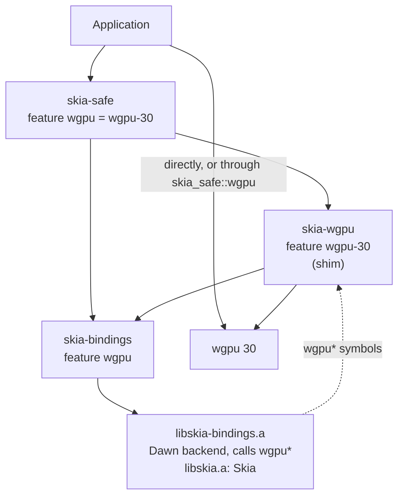
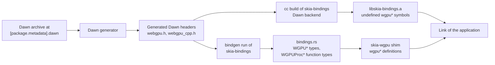
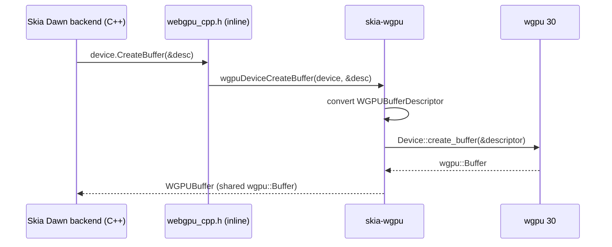
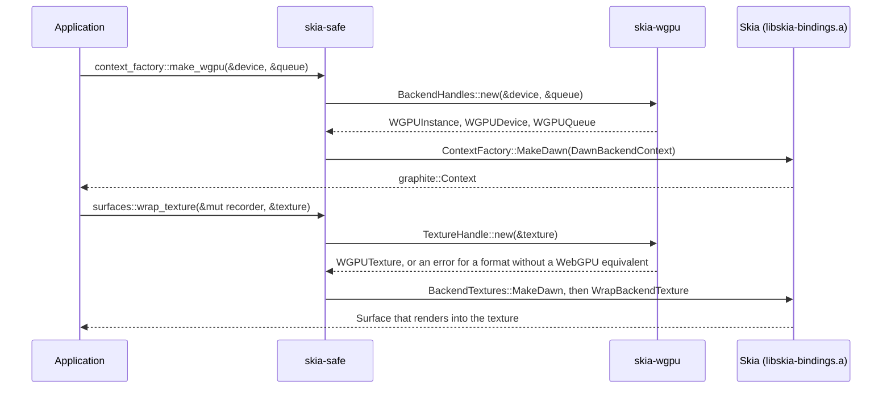
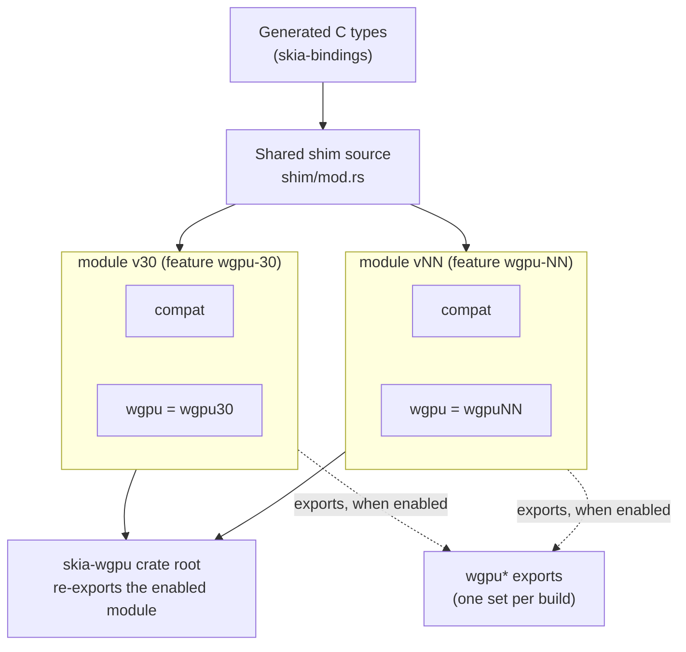

# Skia on `wgpu`: architecture

This document shows how Skia runs inside a `wgpu` application. The decisions behind it are recorded
in ADR 0003 (`docs/adr/0003-skia-runs-on-wgpu-through-a-webgpu-shim.md`) and in ADR 0004
(`docs/adr/0004-the-shim-exports-the-webgpu-functions-from-rust.md`), which decides how Skia's
calls reach the shim.

The document shows the design of the ADRs. Two parts of it appear only with the second supported
`wgpu` major version: the per-version `compat` module, and the `compile_error!` that rejects more
than one enabled `wgpu-NN` feature. With a single version, there is nothing for the
`compile_error!` to compare.

Terms used below:

- **Dawn backend**: Skia's Graphite backend for WebGPU. Skia names it after Dawn, Google's C++
  WebGPU implementation, but rust-skia links none of Dawn's implementation.
- **Dawn headers**: the C header `webgpu.h` and the C++ wrapper `webgpu_cpp.h`, together with the
  headers that they include. Dawn's generator produces them during source builds with the `wgpu`
  feature of `skia-bindings`, from the Dawn revision in `[package.metadata].dawn`.
- **Shim**: the `wgpu*` functions of `webgpu.h` that the Dawn backend calls, defined in the crate
  `skia-wgpu` as Rust functions with `#[no_mangle]`. Each of them converts its C arguments and
  calls the `wgpu` crate.

## Crate dependencies

An arrow points from a crate to a crate it depends on. The dotted arrow is not a Cargo dependency.
It shows that the linker resolves the `wgpu*` functions that Skia's library calls to the shim's
definitions. On ELF targets, Skia's Dawn backend declares these functions with hidden visibility,
so a shared library that contains Skia keeps them to itself and binds Skia's calls inside it.

The application and `skia-wgpu` must use the same `wgpu` major version, so that a `wgpu::Device` of
the application is the type that `skia-safe` accepts. An application that takes its `wgpu` crate
from `skia_safe::wgpu` gets that version without naming it.

## Build inputs

The generated Dawn headers feed both the compilation of Skia's Dawn backend and bindgen. Struct
layouts, enum values, and function signatures therefore come from one source on both sides of the
`wgpu*` calls.

Next to each shim function, an assignment to its `WGPUProc*` type makes rustc check the function's
signature against the header. A function that the Dawn backend calls and the shim lacks usually
fails the link with an undefined symbol that names the function. The list of undefined `wgpu*`
symbols of `libskia-bindings.a` is the authoritative check.

## Path of one WebGPU call

When Skia creates a buffer, the call leaves Skia's C++ code through Dawn's inline C++ wrapper and
arrives directly in the shim, which calls `wgpu`. No function table sits in between.

`wgpu` then runs the work on whichever native API it uses: Metal, Vulkan, Direct3D 12, or
OpenGL ES.

## Creating a Graphite context and a surface

The application passes its own `wgpu` objects to `skia-safe`'s module `gpu::graphite::wgpu`.
`skia-wgpu` wraps clones of them in WebGPU handles, so Skia and the application share one device,
its queue, and its textures.

`images::wrap_texture` wraps a texture as an image in the same way, with
`BackendTextures::MakeDawn` and `SkImages::WrapTexture`, so that Skia samples the application's
texture when it draws the image.

## Several `wgpu` major versions

`skia-wgpu` offers a feature `wgpu-NN` for each supported `wgpu` major version. Each feature
enables the module `vNN`, which binds the name `wgpu` to that version's crate and compiles the one
shared shim source. Its `compat` module holds the few places where that version's API differs.
All modules convert from the same generated C types.

A build enables exactly one `wgpu-NN` feature, because each version would export the same `wgpu*`
symbols. With the second supported version, `skia-wgpu` stops the build with a `compile_error!`
when more than one is enabled. Its `links` key keeps a second version of `skia-wgpu` out of the
dependency graph. `skia-safe` forwards
each `wgpu-NN` feature, and its feature `wgpu` enables the version that the release recommends.
Every `wgpu-NN` feature of `skia-safe` also enables its hidden feature `_wgpu`, on which all of
`skia-safe`'s `wgpu` code depends, so that code never names a version.

A new Skia milestone changes the generated C types, and the shared source is updated once. A new
`wgpu` major version adds a feature, a renamed dependency, and a `compat` module. `skia-bindings`
does not depend on the `wgpu` version, so one prebuilt binary per feature set serves every version.
